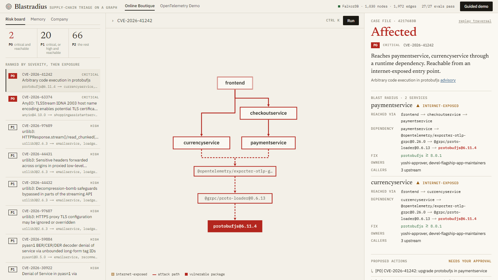
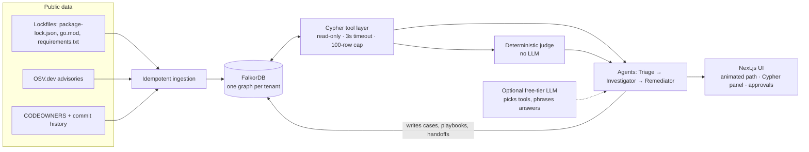

# Blastradius

**A supply-chain vulnerability triage agent whose brain is a FalkorDB graph.**
A new CVE drops. Blastradius answers: *are we affected, through which path, who owns it, what did we decide last time, and what should we do?* Every answer is a graph traversal you can see, and the product stops working if you turn FalkorDB off.

Built for **Graph Hacks: Context for AI Agents** (WeMakeDevs × FalkorDB), entering **all three tracks**.

| Track | What Blastradius does |
|---|---|
| 1 · Agents That Act on Connected Data | Multi-hop traversals (`service → package → … → vulnerable package`), blast radius over the service call graph, PageRank exposure, a deterministic judge, and **human-gated** action proposals. |
| 2 · Agent Memory & Coordination | Episodic cases, procedural playbooks with success counts, three agents (Triage → Investigator → Remediator) handing off through graph state, and **one graph per tenant** for hard isolation. |
| 3 · Company Brain | Ownership from CODEOWNERS, expertise from commit history, dependency decisions **traced to the source commit**, `SUPERSEDES` edges marking stale knowledge. |



<sub>A critical advisory traced hop by hop from the internet-exposed frontend to the vulnerable package. The right column is the case file: verdict, blast radius, owners, precedent, gated actions and every Cypher query. Light and dark themes follow your OS.</sub>

## Why a graph (and not a vector DB)
The question *"does this CVE reach production?"* is a path query: advisory → package → dependency chain → service → caller chain → internet-exposed entry point. A similarity search can't prove a path exists, and it certainly can't prove one doesn't. With a graph, **"no path found" is evidence**, which is how Blastradius proves Log4Shell does not affect a Node/Go/Python stack.

## Try it in 60 seconds
Open the app and click **Guided demo**. It plays the whole story with captions: critical CVE → animated traversal → human approval → memory → the next advisory cites the precedent → proof by absence → company brain → tenant isolation.

## Run it ($0, no accounts)
Requirements: Docker, Python 3.12+, Node 20+.

```bash
docker compose up -d falkordb                      # FalkorDB (browser UI on :3000)

cd backend
python -m venv .venv && .venv/Scripts/activate     # or: source .venv/bin/activate
pip install -r requirements.txt
python -m blastradius.build                        # builds both tenant graphs from public data (~1 min)
uvicorn blastradius.api:app --port 8000

cd ../web && npm install && npm run dev -- -p 3001 # http://localhost:3001
```
Or everything in containers: `docker compose --profile seed run --rm seed && docker compose up -d --build`.

Optional: `GEMINI_API_KEY` (free tier) lets an LLM choose tools and phrase answers. Without it a deterministic router answers the same tools, so the app works with **no LLM and no cost**. Optional `GITHUB_TOKEN` lifts the anonymous GitHub API rate limit during ingestion.

## Architecture

The LLM never sees a database credential and never writes Cypher. It can choose a tool and phrase the result; it **cannot change a verdict**. The verdict (`AFFECTED / NOT_AFFECTED / NEEDS_HUMAN`) is computed from graph evidence by plain rules in [`triage.py`](backend/blastradius/triage.py).

## Graph data model
```
(Repo)-[:CONTAINS]->(Service)-[:CALLS]->(Service)
(Service)-[:DEPENDS_ON {direct, dev}]->(Package)-[:DEPENDS_ON {dev}]->(Package)
(Advisory)-[:AFFECTS {fixed}]->(Package)        (Alias)-[:ALIAS_OF]->(Advisory)   // CVE-… ⇄ GHSA-…
(Owner {kind: team|person|bot})-[:OWNS]->(Service)
(Owner)-[:COMMITTED {count,last}]->(Service)
(Commit)-[:TOUCHED]->(Service)
(Decision)-[:DOCUMENTED_IN]->(Commit) ; (Decision)-[:CONCERNS]->(Service|Package) ; (Decision)-[:SUPERSEDES]->(Decision)
-- memory, written by the agents --
(Case {decision, rationale, actor, ts, reused})-[:ABOUT]->(Advisory) ; (Case)-[:IN]->(Service) ; (Case)-[:USED]->(Playbook {successes, failures})
(Run)-[:HAS_STEP]->(Step {agent, tool, summary, ms}) ; (Step)-[:HANDS_OFF_TO]->(Step)
```

## The Cypher the product depends on
All in [`queries.py`](backend/blastradius/queries.py) and [`memory.py`](backend/blastradius/memory.py); the UI shows the exact query and latency for every step.

| Purpose | Technique |
|---|---|
| Path from every service to a vulnerable package | `shortestPath((s)-[:DEPENDS_ON*1..15]->(p))` per `(Advisory)-[:AFFECTS]->(Package)` |
| Blast radius / who calls this | variable-length `(c:Service)-[:CALLS*0..6]->(s)` |
| Is it reachable from the internet? | `shortestPath` from `Service {exposed:true}` over `CALLS` |
| Which services matter most | `CALL algo.pageRank('Service','CALLS')` |
| Precedent from memory | 3-hop `(Case)-[:ABOUT]->(Advisory)-[:AFFECTS]->(Package)` matched by package name across advisories |
| Proof by absence / version outside range | empty traversal, plus `Package` presence by name to explain *why* |
| Ownership, expertise, decisions | `OWNS`, `COMMITTED`, `Decision-[:DOCUMENTED_IN]->Commit` with `SUPERSEDES` for staleness |

## Does it work? [EVALS.md](EVALS.md)
`python -m evals.run` recomputes ground truth **without the graph** (raw lockfiles, cached OSV data, the curated call list, CODEOWNERS) and compares it with the product's answers: affected-service sets and verdicts for every advisory, path validity (every hop is a real lockfile edge), exposure distance, ownership, transitive callers, proof-by-absence, memory reuse, tenant isolation and guardrails. Currently **27/27**. Plus 10 unit tests on a hand-built fixture graph (`pytest backend/tests`).

## Guardrails
- Agent read path: write keywords rejected, `GRAPH.RO_QUERY` (the database also refuses writes), 3 s timeout, 100-row cap.
- Remediation actions are *proposals*: nothing is executed; approval records the decision as memory.
- Unknown identifiers go to `NEEDS_HUMAN`, never a guess. Dev-only dependency paths go to `NEEDS_HUMAN`.
- If FalkorDB is down the UI says so and nothing answers: there is no cache and no fallback, by design.

## Data & rules compliance
Only public data: OSV.dev advisories, the public lockfiles / `CODEOWNERS` / commit metadata of two open-source projects ([open-telemetry/opentelemetry-demo](https://github.com/open-telemetry/opentelemetry-demo), [GoogleCloudPlatform/microservices-demo](https://github.com/GoogleCloudPlatform/microservices-demo)) treated as two "companies" (tenants). Service-to-service `CALLS` edges are curated from those projects' public architecture docs. Contributor info is limited to public GitHub handles in commit metadata; bots are labelled as bots. No private, paywalled or personal data. The advisory set is a snapshot as of ingestion time.

## AI assistance disclosure
This project was built with **Claude Code** as a coding assistant (Anthropic), directed and reviewed by the author. The graph model, queries, deterministic-judge rules, guardrails and evals were designed to be explainable end to end; the eval suite exists specifically to verify the assistant-written code against an independent computation.

## Repo layout
```
backend/blastradius/   ingest · parsers · osv · queries · triage (agents+judge) · memory · brain · agent · api
backend/tests, backend/evals
web/                   Next.js UI (graph canvas, panels, guided demo)
docker-compose.yml     falkordb + api + web (+ seed profile)
```

## Limitations (honest)
Reachability is package-level, not function-level: a vulnerable function that is never called still counts as a path. Go `go.mod` gives a flat module list (no transitive edges). `CALLS` edges are curated rather than discovered from traces. These are the next things to add (call-graph reachability, SBOM import, OpenTelemetry trace ingestion).
